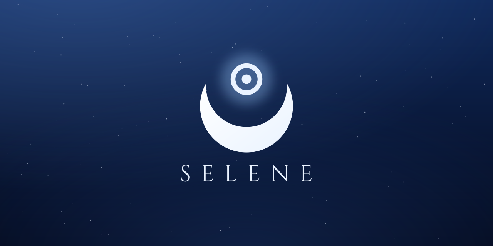
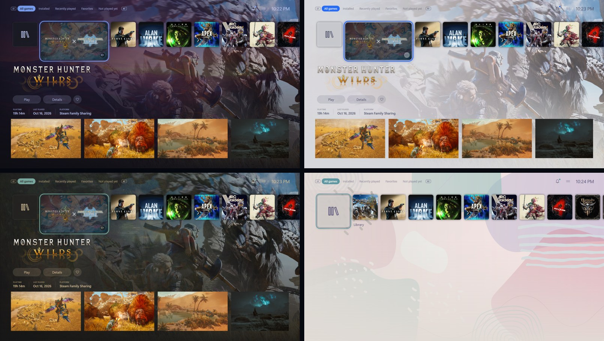
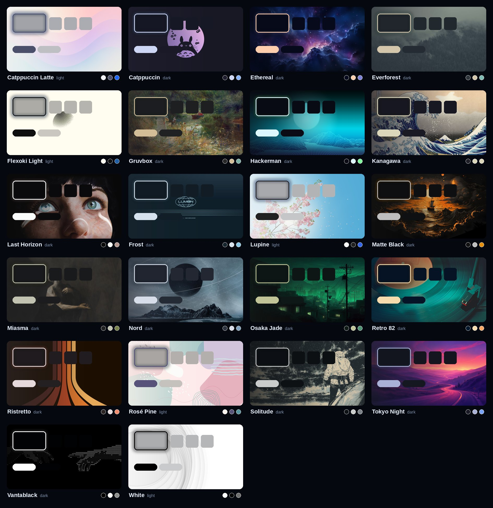
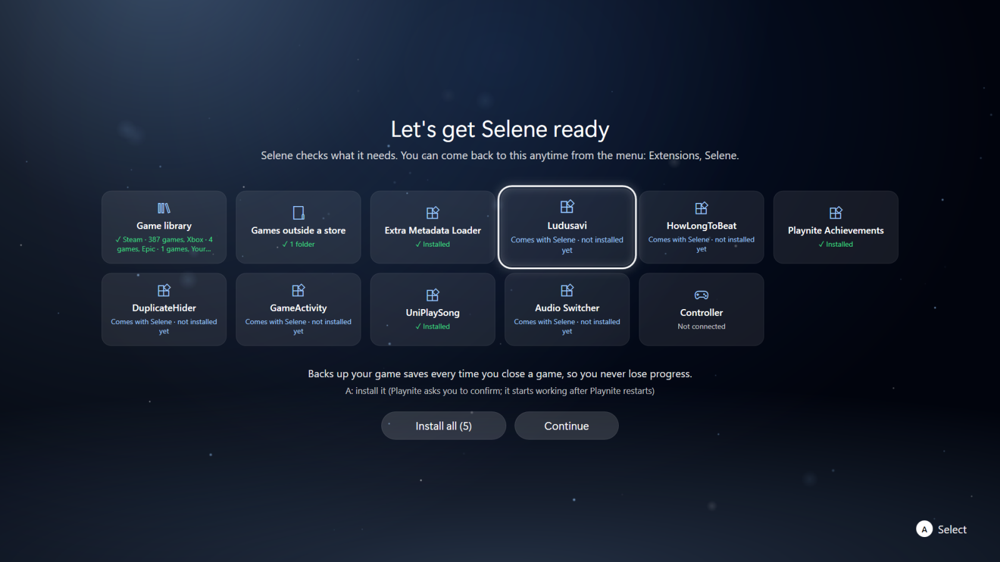
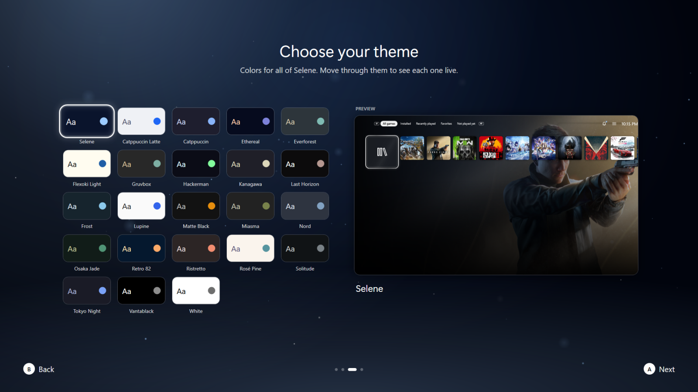
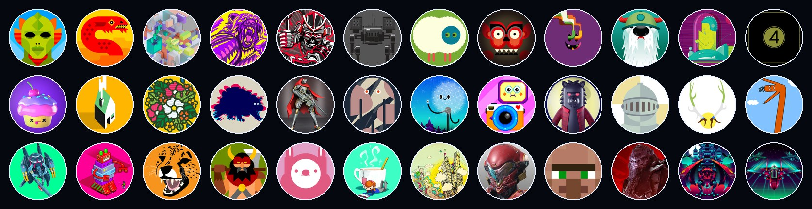

<p align="center">
  
</p>

<p align="center">
  
  
  
  <a href="LICENSE"></a>
</p>

<p align="center">
  A calm, console-style fullscreen theme for <a href="https://playnite.link">Playnite</a>, named after the Greek goddess of the moon.<br>
  Selene comes with <b>Selene Core</b>, a companion add-on that brings the home screen, the login and the launch experience to life.
</p>


| | |
|---|---|
|  |  |
|  |  |

## Themes

**23 color themes**, each with its own wallpaper: Selene's moonlight blue plus Catppuccin, Nord, Gruvbox, Kanagawa,
Rosé Pine, Tokyo Night and more, dark and light. Every screen follows the theme, and the home blends the selected
game's art into your wallpaper (or shows art only, or the wallpaper only). Here: Tokyo Night, Catppuccin Latte,
Gruvbox and Rosé Pine.





## Profiles and first launch

**A first-launch setup** that gets everything ready from the couch: it checks your game library, installs the add-ons
Selene works with (logos and trailers, save backups, HowLongToBeat, achievements and more, each explained), and sets
up save backups with Ludusavi.

**Profiles for everyone in the house.** Each person gets their own name, avatar, theme, wallpaper, favorites and
recently played. Pick from 415 avatars or use your own picture; themes and backgrounds are previewed live on your
real home while you choose.

| | |
|---|---|
|  |  |



## Features

**Home**
- One row of your games: the selected tile grows and plays the game's trailer, the art fills the screen behind it.
- The game's logo with **Play / Details / Favourite**, playtime, last played and platform.
- The selected game's screenshots underneath (fetched automatically, cached locally); A opens them full screen.
- LT / RT switch filters: All games, Installed, Recently played, Favorites, Not played yet.
- A **Library** tile opens the full grid of Playnite's library; B goes back home.

**Who's playing?**
- Starts every launch, after the crescent crown intro: your profiles, each glowing in its own theme's color.
- Add a profile, edit it (Y) or remove it (X twice); a power button for Sleep, Restart, Shut Down.
- From the home: Menu, Extensions, Selene - switch profile, edit your profile, or run the setup check again.
- Keyboard works too (Enter, Esc, arrows, and typing your name).

**Playing**
- Press Play and a loading screen fades in at once with the game's art and logo; it stays until the game is really
  showing something (its own window is up *and* it's making sound), then fades through black into the game.
- Guide button: back to the home while a game runs (the game is paused), and back into the game.
- Close Game from the home, with a closing screen.

**Automatic, for every game** - no per-game setup:
- Online games (anti-cheat or an internet connection) are never frozen when you leave them, only muted.
- Games that need administrator rights get a no-prompt launcher after their first run (one Windows prompt, once).
- A wrong or generic game folder (Downloads, Desktop...) is corrected from where the game actually runs.
- Games in your own folders (installed outside a store) are added; installers and downloads are ignored; games whose
  folder is gone are marked not installed.

## Requirements

- Playnite 10 or newer (fullscreen mode), Windows 10 / 11
- A controller is recommended (Xbox-style); keyboard works too
- Selene's first-launch setup installs the add-ons it works with: Extra Metadata Loader, Ludusavi (plus the
  Ludusavi program for save backups), HowLongToBeat, Playnite Achievements, DuplicateHider, GameActivity, UniPlaySong
  and Audio Switcher

## Install

1. Download `Selene.pthm` and `SeleneCore.pext` from the [Releases](../../releases) page.
2. Open each file (or drag it onto Playnite) and confirm the installation. Restart Playnite.
3. Fullscreen mode -> **Menu -> Settings -> Appearance -> Theme -> Selene**.

Selene Core only does something while the Selene theme is in use.

## Selene Core settings

Playnite -> Add-ons -> Generic -> **Selene Core** (desktop mode):

| Setting | What it does |
|---|---|
| Media folder | Where Selene keeps art, preview clips and screenshots (default: Selene Core's own data folder) |
| Game folders | Folders with games no store knows about; they're added to the library automatically |
| Your wallpapers folder | Images in it show up in the background picker, next to Selene's own |
| Login picture | A picture offered in the avatar picker (default: your Steam avatar) |
| Optional extras | A companion helper with admin rights, and game-streaming host integration - leave empty if unsure |

**Your own art:** put images named after the game's Playnite ID into the media folder:
`Hero\<GameId>.jpg` (16:9 background art) and `Square\<GameId>.jpg` (square home tiles). Without them Selene uses the
game's background and cover.

## Building from source

No Visual Studio needed - Selene Core builds with the C# compiler that ships with Windows.

```powershell
tools\build.ps1          # builds SeleneCore\bin\SeleneCore.dll
tools\dev.ps1 new        # restart Playnite on the Selene in this repo (dev.ps1 back = previous theme)
tools\package.ps1        # Selene.pthm + SeleneCore.pext in dist\
```

For development, add `SeleneCore\bin` to Playnite's developer add-ons (Settings -> For developers) and link `theme\`
into `%APPDATA%\Playnite\Themes\Fullscreen\Selene_a98e0027-fa6a-4f5e-a087-bad8d69f2443`.

## Credits

- Built on [Playnite](https://github.com/JosefNemec/Playnite)'s fullscreen theme template (MIT).
- Interface sounds: [Kenney](https://kenney.nl) - *Interface Sounds* (CC0).
- Avatars: Xbox gamer pictures, property of Microsoft and the respective game publishers.
- Wallpapers: from the theme collection of [Omarchy](https://github.com/basecamp/omarchy) by DHH and its theme
  contributors, with art by Katsushika Hokusai, Charles William Wyllie, Jan Brueghel the Younger, DVAULTZ, Maxteabag
  and other artists. Each wallpaper stays its artist's property; see
  [THIRD-PARTY-NOTICES.md](THIRD-PARTY-NOTICES.md#wallpapers). Artists can ask for a different credit or removal by
  opening an issue.
- Artwork (crescent crown logo, icons, default cover, Selene's moonlit wallpaper) is Selene's own, drawn in `tools/art`
  and exported by `tools/make_art.py`, and by `tools/make_wallpaper.py`. The logo lettering is [Cinzel](https://github.com/NDISCOVER/Cinzel) (SIL Open Font License).

See [THIRD-PARTY-NOTICES.md](THIRD-PARTY-NOTICES.md). Selene is not affiliated with any console maker.

## License

The code is [MIT](LICENSE). The Selene name and the crescent crown logo are not covered by the MIT license:
forks and derived themes are welcome, but please give them your own name and logo.
