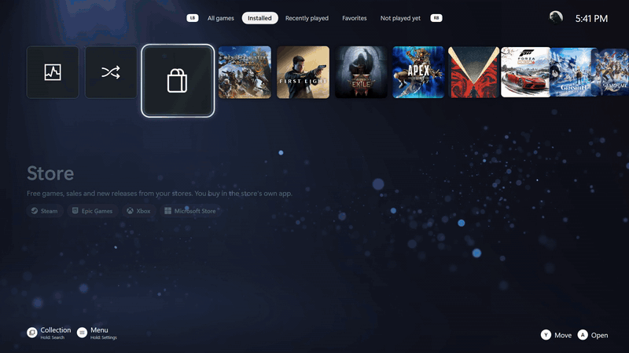
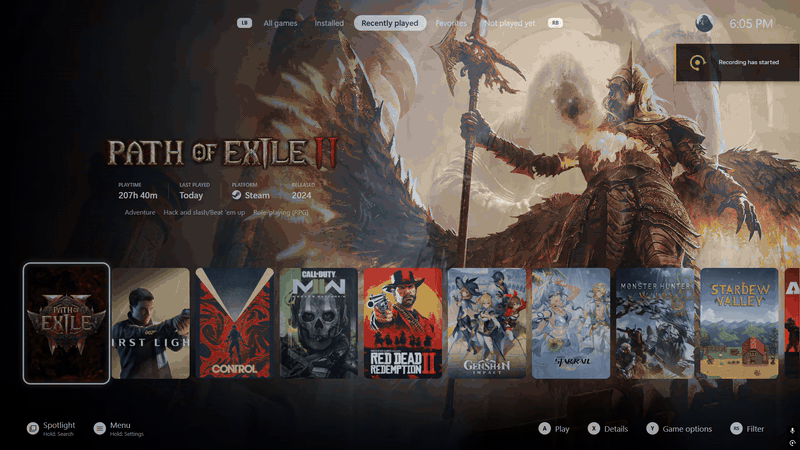
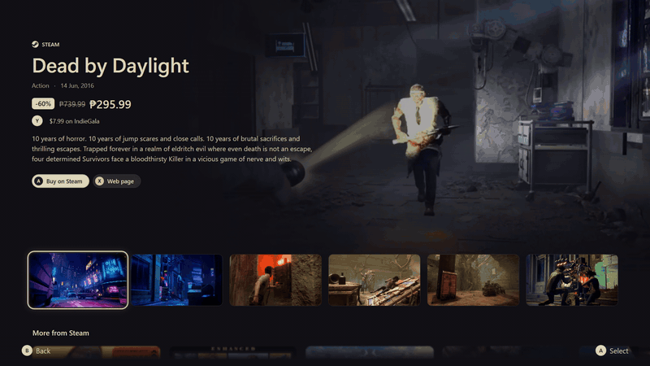
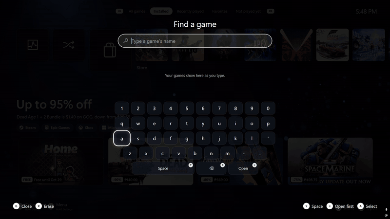
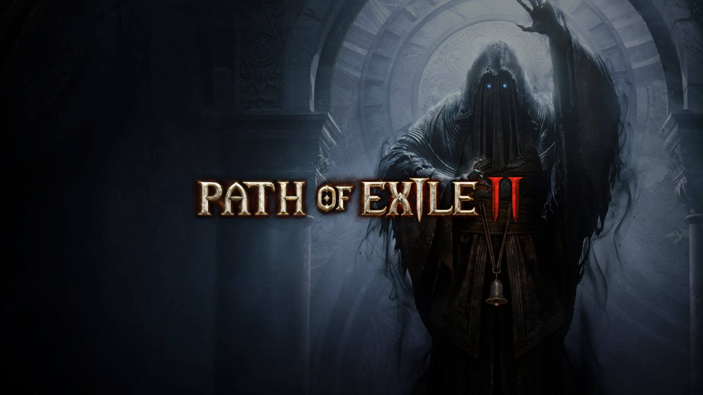
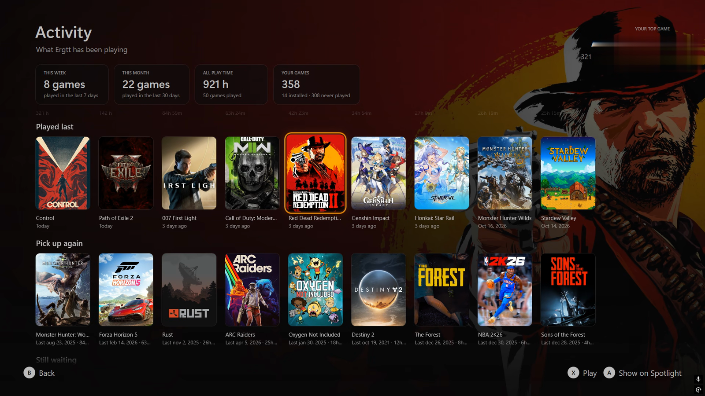
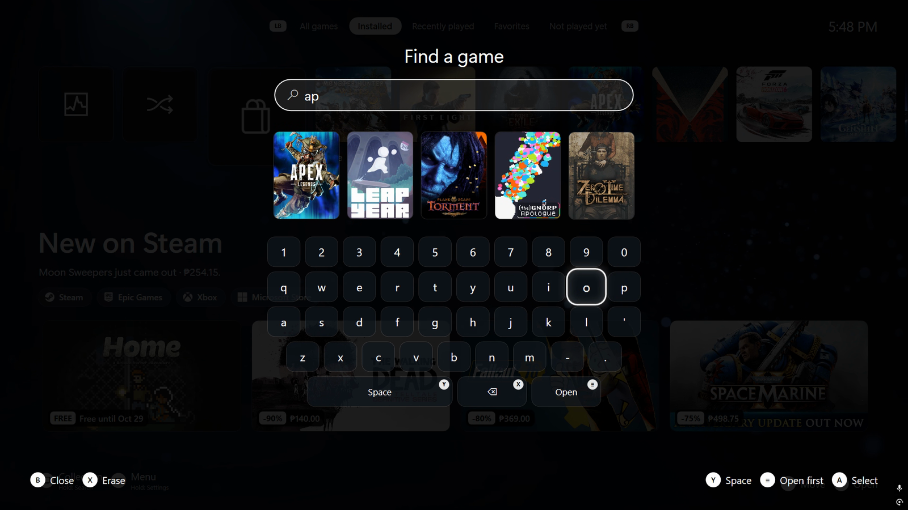
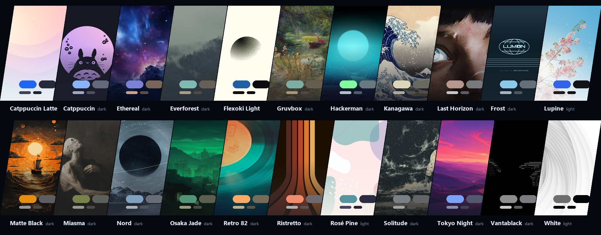
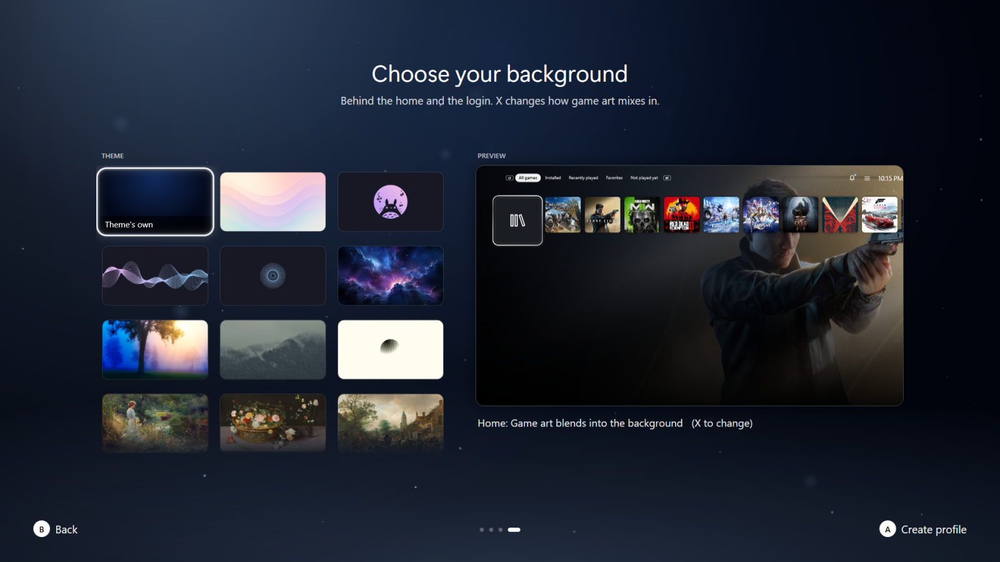

<p align="center">
  
</p>

<p align="center">
  
  
  
  
  <a href="LICENSE"></a>
</p>

<p align="center">
  <b>A calm, console-style fullscreen theme for <a href="https://playnite.link">Playnite</a></b>, named after the Greek goddess of the moon.<br>
  Selene comes with <b>Selene Core</b>, a companion add-on that brings Spotlight, profiles, the menu, the store, your captures and the launch experience to life.
</p>

<p align="center">
  <a href="#install">Install</a> ·
  <a href="#features">Features</a> ·
  <a href="#themes">Themes</a> ·
  <a href="#selene-settings">Settings</a> ·
  <a href="#building-from-source">Build</a>
</p>

## In motion

<table>
  <tr>
    <td width="50%"><p align="center"><sub><b>Spotlight</b> One row: your cards, then your games. The art fills the screen as you move</sub></p></td>
    <td width="50%"><p align="center"><sub><b>Play</b> The loading screen fades in at once, waits for the game, then melts through black into it</sub></p></td>
  </tr>
  <tr>
    <td width="50%"><p align="center"><sub><b>Store</b> Free games, sales and new releases; a game's page plays its trailer</sub></p></td>
    <td width="50%"><p align="center"><sub><b>Find a game</b> Hold View, type, and the pick lands on Spotlight</sub></p></td>
  </tr>
</table>

## Screens


<table>
  <tr>
    <td width="50%"><p align="center"><sub><b>Who's playing?</b> Every profile in its own theme color</sub></p></td>
    <td width="50%"><p align="center"><sub><b>Launching</b> The game's art, drifting slowly, until the game is really on screen</sub></p></td>
  </tr>
  <tr>
    <td width="50%"><p align="center"><sub><b>Details</b> Scores, genres, screenshots, your captures and activity, more like it</sub></p></td>
    <td width="50%"><p align="center"><sub><b>Activity</b> Your numbers, your most played, games to pick up again</sub></p></td>
  </tr>
  <tr>
    <td width="50%"><p align="center"><sub><b>Store page</b> Trailer, price, screenshots full screen, more from the store</sub></p></td>
    <td width="50%"><p align="center"><sub><b>Find a game</b> Results show as you type</sub></p></td>
  </tr>
  <tr>
    <td width="50%"><p align="center"><sub><b>Collection</b> Every game, with its art crossfading behind</sub></p></td>
    <td width="50%"><p align="center"><sub><b>Menu</b> A control-center row along the bottom</sub></p></td>
  </tr>
</table>

## Features

### Spotlight
- **One row.** A few cards, then your games. The selected tile lifts, the game's art fills the screen and its logo,
  playtime, last played and platform appear with **Play / Details / Favorite**.
- **Trailer cards.** Rest on a game and its tile grows into a 16:9 card playing the trailer; the game's own song plays
  with it (R3 switches to the trailer's sound). Otherwise your default music keeps playing.
- **Screenshots** of the selected game underneath, fetched and cached automatically; A opens them full screen.
- **Cards, each with a headline and pictures under it** (Down goes into them, A opens one):
  - **Captures**: your screenshots and clips, newest first, from Steam, Xbox Game Bar, the NVIDIA app and folders you
    add. A grid on a dark vignette, filters for screenshots or clips, a viewer that plays clips with sound, pause and seek.
  - **Activity**: this week's and all-time numbers, your top game, most played with bars, played last, games to pick up
    again and games still waiting. A shows one on Spotlight, X plays it.
  - **Surprise me**: covers flick past and stop on a game to play (installed, not played yet, or all).
  - **Store**: the free games of the week, sales and new releases from the store apps on your PC. A game's page plays
    its trailer, shows its price, its screenshots full screen and more from that store.
- **Find a game**: hold View, type on the on-screen keyboard, results show as you type; the pick lands on Spotlight's
  row where a move would put it.
- **LB / RB filters**: All games, Installed, Recently played, Favorites, Not played yet. LT / RT jump to either end.
- **Game details**: who made it, critic and player scores, genres, the description, then bands that glide up as you
  go down: its screenshots, your captures of it beside your activity with it, and more games like it from your own
  collection. The next band peeks in at the foot of the screen.
- A clean screen like a console's: no button hints unless you want them.

### Collection
- **Playnite's full grid** with Selene's look: the art crossfades from game to game, trailers play when you rest on a
  game, A plays it the same way Spotlight does, X opens its details, Y its options.

### Menu
- **Start opens a control-center row** along the bottom over the dimmed home: switch or edit your profile, update the
  library, Selene settings, the setup check, Playnite's settings and desktop mode.
- **Playnite's settings open as a Selene screen**: General, Visuals, Audio, Layout, Menus and Input as sections,
  with Selene's switches and choices, saved straight into Playnite.
- **Playnite's dialogs, progress window and a game's options menu** wear Selene's look too: glass cards, pill buttons.
- **Power** opens sleep, restart, shut down and exit right above it.

### Profiles and first launch
- **A crescent intro, then Who's playing?** Each person has their own name, avatar, theme, wallpaper, favorites and
  recently played. 415 avatars to pick from, or frame your own picture.
- **Themes and backgrounds are previewed live** on your real home while you choose, with the theme's colors and
  wallpaper on every tile.
- **A first-launch setup** from the couch: checks your library, installs the add-ons Selene works with (logos and
  trailers, save backups, HowLongToBeat, achievements, music...) with a word on each, and sets up save backups.

### Playing
- **Press Play** and a loading screen fades in at once with the game's art and logo, drifting slowly. It stays until
  the game is really showing something (its window is up *and* it's making sound), then fades through black into the
  game, which fades in out of the black.
- **Guide** takes you back to the home while a game runs (the game pauses) and back into it.
- **Close Game** from the home, with a closing screen.
- **Save backups** happen quietly after each game (Ludusavi), with no question every time.

### Automatic, for every game
- Online games (anti-cheat or an internet connection) are never frozen when you leave them, only muted.
- Games that need administrator rights get a no-prompt launcher after their first run (one Windows prompt, once).
- A wrong or generic game folder (Downloads, Desktop...) is corrected from where the game actually runs.
- Games in your own folders are added; installers and downloads are ignored; games whose folder is gone are marked
  not installed.

### Feel
Every screen moves and sounds like a console: things rise and fade in, focus glides with a soft glow, screens
crossfade, and every move, confirm and back has its sound, all leveled to sit together. The animated background and
the loading screen's art are drawn on threads of their own, so a game starting can't make them stumble.

## Themes

**23 color themes**, each with its own wallpaper: Selene's moonlight blue plus Catppuccin, Nord, Gruvbox, Kanagawa,
Rosé Pine, Tokyo Night and more, dark and light. Every screen follows the theme; its wallpaper (or, on Selene's own
theme, a breathing glow with drifting particles) shows wherever there's no game art.



<table>
  <tr>
    <td width="50%"><p align="center"><sub><b>Choosing a theme</b> Live on your home, with its colors</sub></p></td>
    <td width="50%"><p align="center"><sub><b>Choosing a background</b> Game art or the wallpaper alone</sub></p></td>
  </tr>
</table>


## Install

1. Download `Selene.pthm` and `SeleneCore.pext` from the [Releases](../../releases) page.
2. Open each file (or drag it onto Playnite) and confirm the installation. Restart Playnite.
3. Fullscreen mode -> **Menu -> Playnite settings -> Appearance -> Theme -> Selene**.

Selene Core only does something while the Selene theme is in use. On the first start Selene walks you through the rest.

**Requirements:** Playnite 10 or newer (fullscreen mode), Windows 10 / 11. A controller is recommended (Xbox-style);
the keyboard works too (Enter, Esc, arrows, typing).

## Selene settings

**Everything Selene adds can be switched off**, from the menu (**Selene settings**) or Playnite -> Add-ons -> Generic ->
**Selene Core** in desktop mode. Some settings are a choice of values (Left / Right go round them).

| Group | Setting | What it does |
|---|---|---|
| Start-up | Logo intro | The Selene logo when Playnite starts |
| | Who's playing? | Pick a profile at start. Off: the last one signs in by itself |
| | Start on Collection | Open on all your games instead of Spotlight (off by default) |
| | Library update at start | Playnite looks for new and removed games 20 s after it starts |
| Navigation | View button | Switches Spotlight and Collection; hold it to search |
| | Button hints | What each button does, along the bottom |
| | Playnite settings, Selene's way | The menu's Playnite settings open as a Selene screen |
| Spotlight | Activity, Captures, Surprise me, Collection cards | Each card on or off (Collection is off by default: the View button opens it) |
| | Pictures under the cards | The latest captures, the games you played last and a few ideas under their cards |
| | Trailer cards after | 1 s, 2.5 s, 5 s or never |
| | Trailer sound | Trailer cards start with their sound on |
| | Starting tab | The filter tab Spotlight opens on |
| Sound & music | Interface sounds | Sounds when you move, select and go back |
| | Music control | Default music while browsing, a game's song with its trailer (needs UniPlaySong) |
| | Quiet loading screen | A starting game stays quiet until it shows |
| | Sound volume | How loud Selene's own sounds are |
| Look | Selene logo | The logo in Selene settings and on empty screens |
| | Profile in the top bar | Your avatar beside the clock |
| | Readable text | A soft halo behind text so it reads over bright pictures |
| | Animated background | The moving backdrop behind the login and cards |
| | Collection trailers | Rest on a game in Collection and its trailer plays |
| | Shade over the art | Lighter, as needed, or deeper |
| Games | Store page | The Store card opens free games, sales and new releases. Off: it picks a store app |
| | Store trailers, Store opens on | A game's trailer behind its page; the tab the Store starts on |
| | Surprise me picks from | Installed, not played yet, or all |
| | Freeze on Guide | Guide pauses offline games. Off: they're only muted |
| | Close to tray | Exit hides Playnite so it comes back instantly |
| | No-prompt launchers | Admin games skip the Windows prompt after their first run |
| | Quiet save backups | Ludusavi backs up a game's saves without asking each time |

The add-on page also has the folders: where Selene keeps art and clips, your capture folders, folders with games no
store knows about, your own wallpapers, and optional extras (a companion helper, game-streaming host integration;
leave them empty if unsure).

**Your own art:** put images named after the game's Playnite ID into the media folder: `Hero\<GameId>.jpg` (16:9
background art) and `Square\<GameId>.jpg` (square home tiles). Without them Selene uses the game's background and cover.

## Building from source

No Visual Studio needed: Selene Core builds with the C# compiler that ships with Windows.

```powershell
tools\build.ps1          # builds SeleneCore\bin\SeleneCore.dll
tools\dev.ps1 new        # restart Playnite on the Selene in this repo (dev.ps1 back = previous theme)
tools\package.ps1        # Selene.pthm + SeleneCore.pext in dist\
```

For development, add `SeleneCore\bin` to Playnite's developer add-ons (Settings -> For developers) and link `theme\`
into `%APPDATA%\Playnite\Themes\Fullscreen\Selene_a98e0027-fa6a-4f5e-a087-bad8d69f2443`. Color themes are made from
`tools/palettes/*.toml` by `tools/make_palettes.py`; after changing a sound, `tools/level_sounds.py` levels them all;
`tools/make_readme_art.py` redraws the theme strip and the avatars picture above.

## Credits

- Built on [Playnite](https://github.com/JosefNemec/Playnite)'s fullscreen theme template (MIT).
- Menu icons: Google's [Material Icons](https://github.com/google/material-design-icons) (Apache 2.0).
- Sounds: Selene's own (synthesized by `tools/make_sounds.py`) and menu sounds from SQUARE ENIX games, (c) SQUARE ENIX;
  see [THIRD-PARTY-NOTICES.md](THIRD-PARTY-NOTICES.md#sounds).
- Avatars: Xbox gamer pictures, property of Microsoft and the respective game publishers.
- Wallpapers: from the theme collection of [Omarchy](https://github.com/basecamp/omarchy) by DHH and its theme
  contributors, with art by Katsushika Hokusai, Charles William Wyllie, Jan Brueghel the Younger, DVAULTZ, Maxteabag
  and other artists. Each wallpaper stays its artist's property; see
  [THIRD-PARTY-NOTICES.md](THIRD-PARTY-NOTICES.md#wallpapers). Artists can ask for a different credit or removal by
  opening an issue.
- Artwork (crescent crown logo, default cover) is Selene's own, drawn in `tools/art` and exported by
  `tools/make_art.py`. The logo lettering is [Cinzel](https://github.com/NDISCOVER/Cinzel) (SIL Open Font License).
- The pictures and clips on this page show games from the author's own library; their art belongs to their publishers.

See [THIRD-PARTY-NOTICES.md](THIRD-PARTY-NOTICES.md). Selene is not affiliated with any console maker.

## License

The code is [MIT](LICENSE). The Selene name and the crescent crown logo are not covered by the MIT license:
forks and derived themes are welcome, but please give them your own name and logo.
