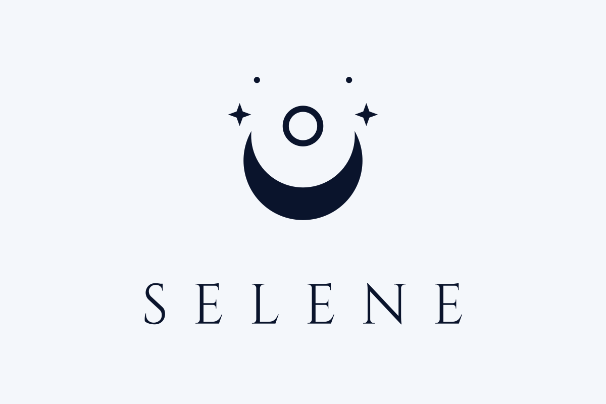
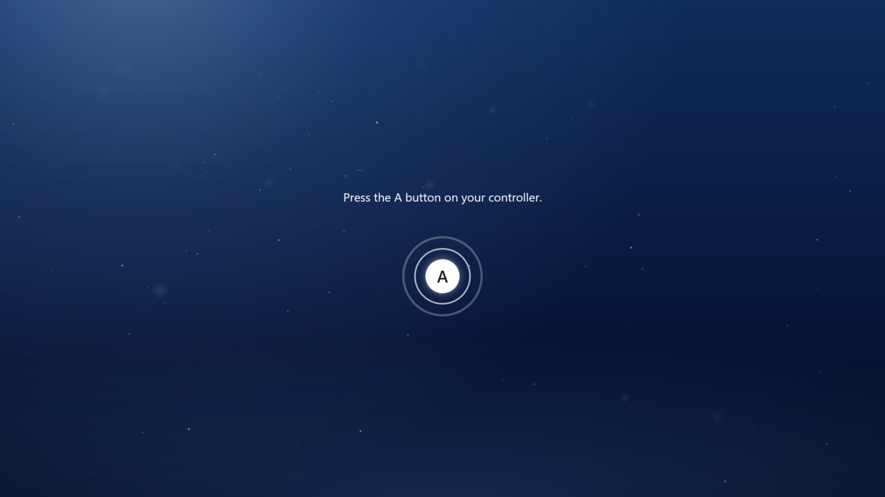
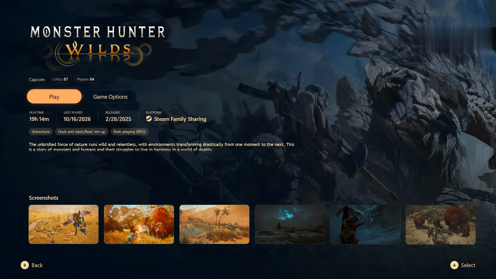
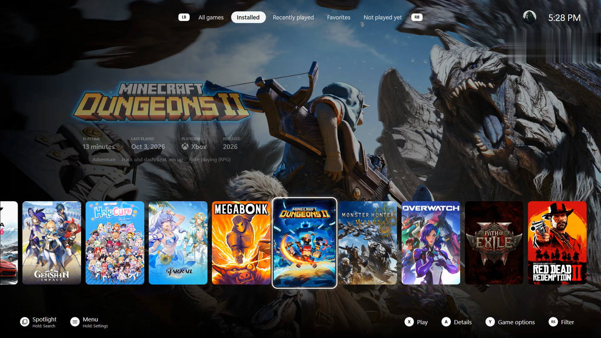
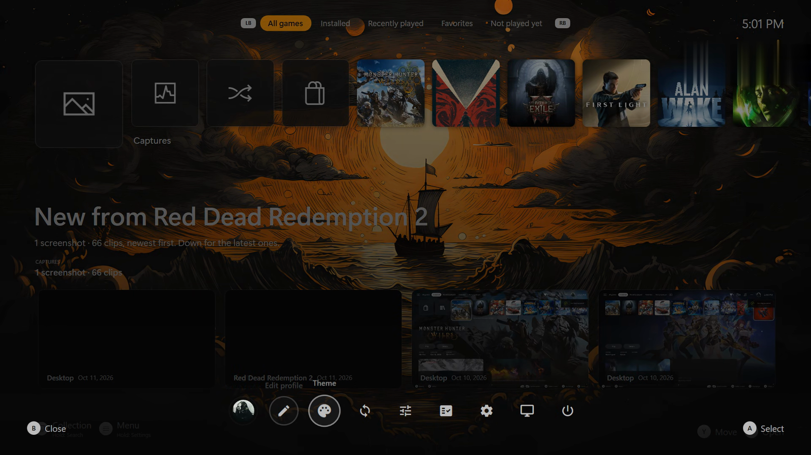

<p align="center">
  <picture>
    <source media="(prefers-color-scheme: dark)" srcset="docs/logo/selene-logo-dark.png">
    
  </picture>
</p>

# Selene

A calm, console-style fullscreen theme for [Playnite](https://playnite.link), named after the Greek goddess of the moon.
Selene comes with **Selene Core**, a companion add-on that brings the home screen, the login and the launch
experience to life.


| | |
|---|---|
|  |  |
|  |  |

## Features

**Home**
- One row of your games: the selected tile grows and plays the game's trailer, the art fills the screen behind it.
- The game's logo with **Play / Details / Favourite**, playtime, last played and platform.
- The selected game's screenshots underneath (fetched automatically, cached locally); A opens them full screen.
- LT / RT switch filters: All games, Installed, Recently played, Favorites, Not played yet.
- A **Library** tile opens the full grid of Playnite's library; B goes back home.

**Login**
- A moonlit scene with drifting particles and *Press A*; your Steam avatar and name (or your own picture and name).
- A power button: Sleep, Restart, Shut Down. Keyboard works too (Enter, Esc, arrows).

**Playing**
- Press Play and a loading screen fades in at once with the game's art and logo; it stays until the game is really
  showing something (its own window is up *and* it's making sound), then fades through black into the game.
- Guide button: back to the home while a game runs (the game is paused), and back into the game.
- Close Game from the home, with a closing screen.

**Automatic, for every game** - no per-game setup:
- Online games (anti-cheat or an internet connection) are never frozen when you leave them, only muted.
- Games that need administrator rights get a no-prompt launcher after their first run (one Windows prompt, once).
- A wrong or generic game folder (Downloads, Desktop...) is corrected from where the game actually runs.
- Games in your own folders (installed outside a store) are added; installers and downloads are ignored; games whose
  folder is gone are marked not installed.

## Requirements

- Playnite 10 or newer (fullscreen mode), Windows 10 / 11
- A controller is recommended (Xbox-style); keyboard works too
- Optional: [Extra Metadata Loader](https://github.com/darklinkpower/PlayniteExtensionsCollection) for game logos and trailers

## Install

1. Download `Selene.pthm` and `SeleneCore.pext` from the [Releases](../../releases) page.
2. Open each file (or drag it onto Playnite) and confirm the installation. Restart Playnite.
3. Fullscreen mode -> **Menu -> Settings -> Appearance -> Theme -> Selene**.

Selene Core only does something while the Selene theme is in use.

## Selene Core settings

Playnite -> Add-ons -> Generic -> **Selene Core** (desktop mode):

| Setting | What it does |
|---|---|
| Media folder | Where Selene keeps art, preview clips and screenshots (default: Selene Core's own data folder) |
| Game folders | Folders with games no store knows about; they're added to the library automatically |
| Login name / picture | Override the Steam name and avatar shown on the login |
| Optional extras | A companion helper with admin rights, and game-streaming host integration - leave empty if unsure |

**Your own art:** put images named after the game's Playnite ID into the media folder:
`Hero\<GameId>.jpg` (16:9 background art) and `Square\<GameId>.jpg` (square home tiles). Without them Selene uses the
game's background and cover.

## Building from source

No Visual Studio needed - Selene Core builds with the C# compiler that ships with Windows.

```powershell
tools\build.ps1          # builds SeleneCore\bin\SeleneCore.dll
tools\dev.ps1 new        # restart Playnite on the Selene in this repo (dev.ps1 back = previous theme)
tools\package.ps1        # Selene.pthm + SeleneCore.pext in dist\
```

For development, add `SeleneCore\bin` to Playnite's developer add-ons (Settings -> For developers) and link `theme\`
into `%APPDATA%\Playnite\Themes\Fullscreen\Selene_a98e0027-fa6a-4f5e-a087-bad8d69f2443`.

## Credits

- Built on [Playnite](https://github.com/JosefNemec/Playnite)'s fullscreen theme template (MIT).
- Interface sounds: [Kenney](https://kenney.nl) - *Interface Sounds* (CC0).
- Artwork (crescent crown logo, icons, default cover) is Selene's own, drawn in `tools/art` and exported by
  `tools/make_art.py`. The logo lettering is [Cinzel](https://github.com/NDISCOVER/Cinzel) (SIL Open Font License).

See [THIRD-PARTY-NOTICES.md](THIRD-PARTY-NOTICES.md). Selene is not affiliated with any console maker.

## License

[MIT](LICENSE)
