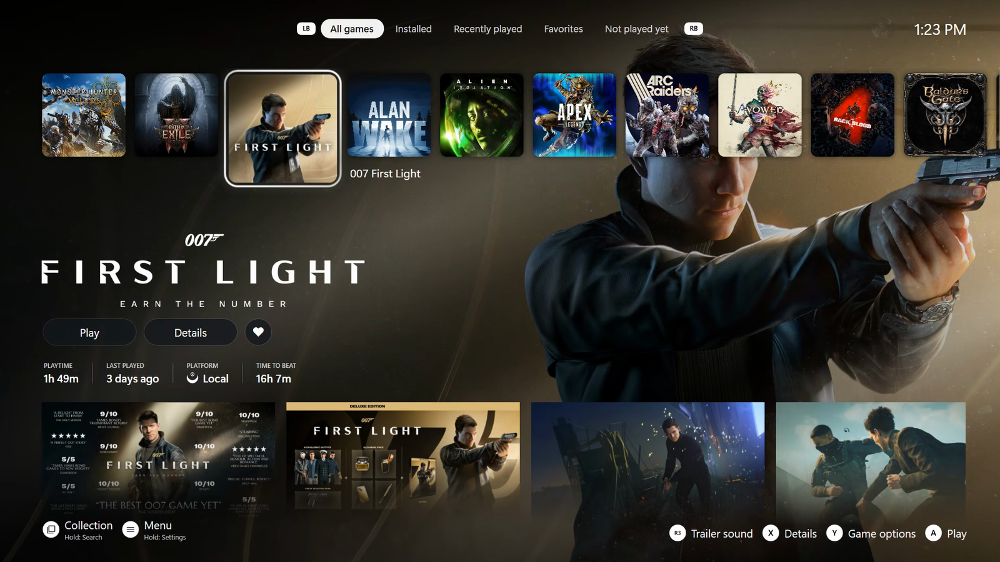

<a href="README.md">Guide</a> · <a href="getting-started.md">Getting started</a> · <a href="spotlight.md">Spotlight</a> · <a href="cards.md">Cards</a> · <a href="store.md">Store</a> · <a href="details-collection.md">Details &amp; Collection</a> · <a href="playing.md">Playing</a> · <a href="menu.md">Menu</a> · <a href="profiles.md">Profiles</a> · <a href="settings.md">Settings</a> · <a href="themes.md">Themes</a> · <a href="troubleshooting.md">Help</a>

# Spotlight

**One row.** A few cards first (Captures, Activity, Surprise me, Store), then your games. The selected tile lifts,
the game's art fills the screen, and its logo, playtime, last played and platform appear with **Play / Details /
Favorite** under it. Six of its screenshots sit along the bottom; A on one shows it full screen.

**Trailer cards.** Rest on a game and its tile grows into a 16:9 card playing the trailer. The game's own song
plays with it (R3 switches to the trailer's own sound); otherwise your default music keeps playing. *Trailer cards
after* in Selene settings sets the wait (1 s, 2.5 s, 5 s or never).

**Filters.** LB / RB go through All games, Installed, Recently played, Favorites and Not played yet, then your own
Playnite filter presets (switch: *Your Playnite filters as tabs*). LT / RT jump to
the start and the end of the row. *Starting tab* picks the tab Spotlight opens on.

**Moving things.** Y lifts a tile or a card; Left / Right carry it; A or Y drops it. The order is remembered per
profile.

**Find a game.** Hold View (or press the left stick). Type on the on-screen keyboard; your games show as you type;
Start opens the first result. The pick lands on Spotlight's row where a move would put it, on All games if the
current tab doesn't have it. From Collection it lands in Collection.

**Button hints** along the bottom are off by default (Navigation → Button hints).
