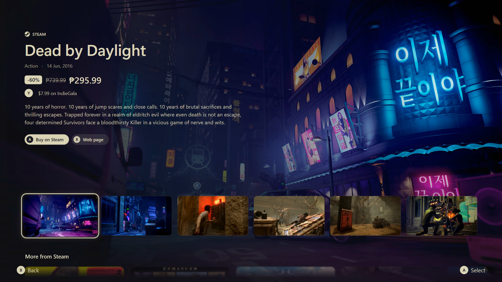

<a href="README.md">Guide</a> · <a href="getting-started.md">Getting started</a> · <a href="spotlight.md">Spotlight</a> · <a href="cards.md">Cards</a> · <a href="store.md">Store</a> · <a href="details-collection.md">Details &amp; Collection</a> · <a href="playing.md">Playing</a> · <a href="menu.md">Menu</a> · <a href="profiles.md">Profiles</a> · <a href="settings.md">Settings</a> · <a href="themes.md">Themes</a> · <a href="troubleshooting.md">Help</a>

# Store

The Store card opens the free games of the week, sales and new releases from the store apps on your PC (Steam, Epic,
Xbox, GOG, Ubisoft, EA, Microsoft Store). LB / RB switch tabs; *Store opens on* picks the one it starts on. The rows
glide up as you go down; the next row peeks in at the foot of the screen.

**A game's page.** The trailer plays behind it (switch: *Store trailers*), with the price, the discount and the
description. The focus starts on **Buy / Play**; Down goes to the screenshots (A shows one on the whole screen,
Left / Right go through them), Down again to **More from** that store. B leaves the page from anywhere on it.

With *Store page* off, the Store card simply opens one of the store apps.
